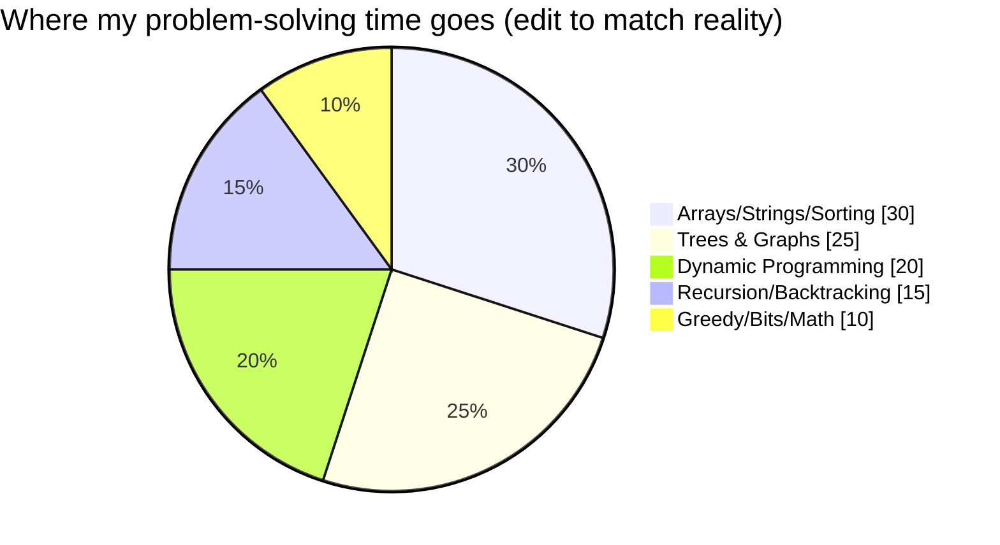
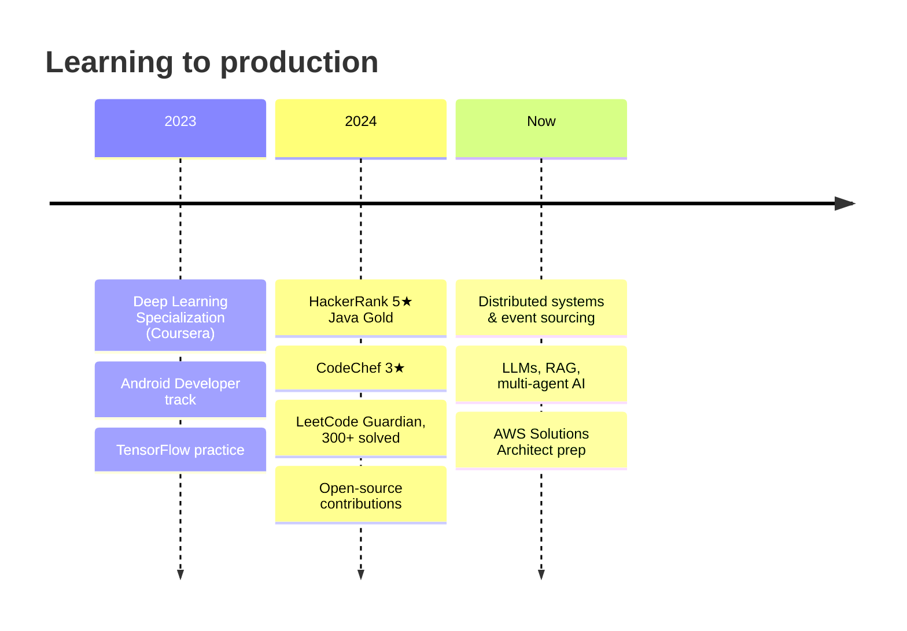

<!-- ═══ ABHAY SINGH YADAV · PROFILE README (single file, no extra assets) ═══ -->


<div align="center">

[](https://github.com/Abhay9889)


</div>


## `$ whoami`

```text
abhay@earth:~$ cat identity.json
{
  "name":      "Abhay Singh Yadav",
  "role":      "Software Engineer · AI builder",
  "superpower":"Connecting three worlds: mobile, backend, ML",
  "fuel":      "coffee + stubborn curiosity",
  "motto":     "Code with intent. Ship with pride."
}

abhay@earth:~$ ./what-makes-me-different.sh
> Most ML people can't ship a backend.
> Most backend people don't touch models.
> Most Android devs never deploy intelligence on-device.
> I do all three, end to end.
```

## 🛰️ The Signal Path: how I build

Every product follows one loop: **a phone captures, a backend orchestrates, a model decides, the edge answers.**


## 🚀 Missions

| Mission | What it does | Stack | Status |
|:--|:--|:--|:--:|
| 🛡️ **NightGuard** | AI surveillance that detects events in video streams | `Python` `OpenCV` `YOLO` `Spring Boot` | 🟡 building |
| 🏙️ **UrbanPulse** | Civic platform connecting citizens and city issues | `Kotlin` `Spring Boot` `PostgreSQL` | 🟡 building |
| 🧰 **Open-source ML toolkits** | Reusable utilities for training and evaluation | `Python` `PyTorch` | 🟢 ongoing |

<!-- TODO: link each mission to its repo, add a screenshot/GIF and one measurable result (e.g. "92% mAP", "-40% latency") -->

## 🧩 Tech Layers

<div align="center">

| Layer | Tools |
|:--|:--|
| **Languages** |  |
| **Backend** |  |
| **Mobile** |  |
| **AI / ML** |  |
| **Cloud / Tools** |  |

</div>

<details>
<summary><b>🎚️ How deep am I, honestly?</b></summary>

| 🔥 Daily drivers | 🙂 Comfortable | 🌱 Exploring |
|:--|:--|:--|
| Java, Spring Boot, Kotlin/Android, Python | TensorFlow/Keras, Docker, SQL, CNNs/LSTMs | PyTorch, Kafka, AWS, RAG, multi-agent systems |

</details>

## 🏆 Arena

<div align="center">

| Platform | Standing | Solved |
|:--|:--|:--:|
| **LeetCode** | Guardian | 300+ |
| **HackerRank** | 5★ Java, Gold | 200+ |
| **CodeChef** | 3★ | 150+ |
| **Codeforces** | Specialist | 100+ |



</div>

## 📈 Live Telemetry

<div align="center">


<picture>
  <source media="(prefers-color-scheme: dark)" srcset="https://raw.githubusercontent.com/Abhay9889/Abhay9889/output/snake-dark.svg"/>
  
</picture>

<details>
<summary>⚙️ <b>Enable the snake (one-time setup)</b></summary>
<br/>

Create `.github/workflows/snake.yml`, then run it once from the Actions tab:

```yaml
name: Generate Snake
on:
  schedule:
    - cron: "0 0 * * *"
  workflow_dispatch:
permissions:
  contents: write
jobs:
  generate:
    runs-on: ubuntu-latest
    steps:
      - uses: Platane/snk@v3
        with:
          github_user_name: ${{ github.repository_owner }}
          outputs: |
            dist/snake.svg
            dist/snake-dark.svg?palette=github-dark
      - uses: crazy-max/ghaction-github-pages@v3.1.0
        with:
          target_branch: output
          build_dir: dist
        env:
          GITHUB_TOKEN: ${{ secrets.GITHUB_TOKEN }}
```

</details>

</div>

## 🧭 Journey



## 📜 Current `git log`

```text
* a1f9c3e (HEAD -> now)   building  NightGuard + UrbanPulse
* 7be2d04                 studying  distributed systems, RAG, multi-agent AI
* 3c8a51b                 reading   Designing Data-Intensive Applications
* 90d4e7a                 prepping  AWS Solutions Architect
* e21b6ff                 learning  zero-trust security patterns
```

## 🤝 Let's Build Something

<details open>
<summary><b>Ask me about…</b></summary>

- Wiring an Android app to a Spring Boot backend that scales
- Shipping a CNN/YOLO model to mobile with TFLite
- Building a RAG pipeline with LangChain
- Cracking DSA interviews: lessons from 500+ problems

</details>

<div align="center">

[](https://github.com/Abhay9889)
[](https://www.linkedin.com/in/YOUR-HANDLE)
[](mailto:YOUR-REAL-EMAIL@gmail.com)

<br/>

*Code with intent. Ship with pride.* 🚀

</div>


