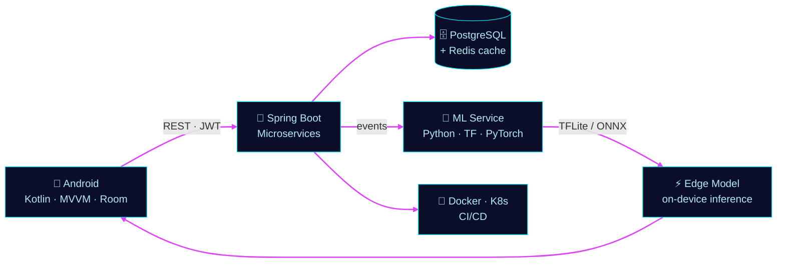
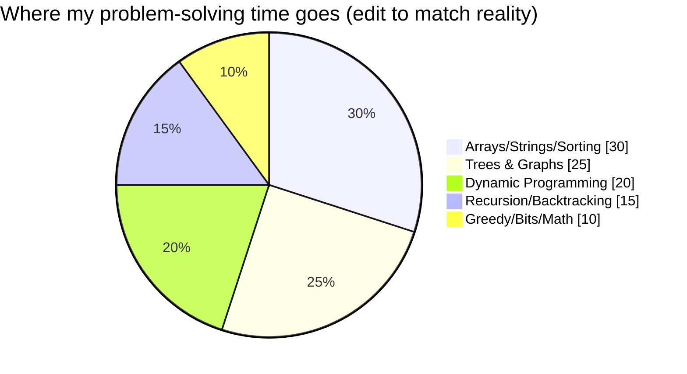
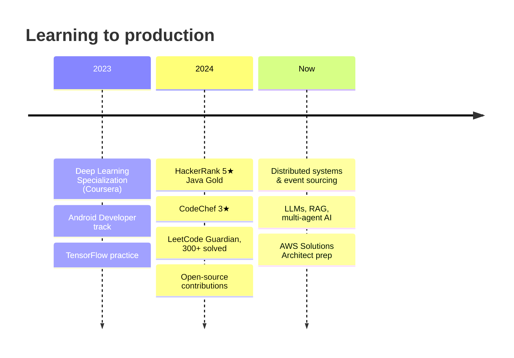

<!-- ═══ ABHAY SINGH YADAV · ULTRA-ANIMATED PROFILE (single file) ═══ -->


<div align="center">

     

<a href="https://github.com/Abhay9889"></a>


<br/><br/>


</div>


<h2> </h2>

<div align="center">
>>+system+ready.+let%27s+build+something." alt="boot sequence"/>
</div>

<div align="center">

<table><tr>
<td align="center"><br/><b>Java</b></td>
<td align="center"><br/><b>Deep Learning</b></td>
<td align="center"><br/><b>Problems solved</b></td>
<td align="center"><br/><b>HackerRank</b></td>
</tr></table>

</div>


<h2> </h2>

**A phone captures → a backend orchestrates → a model decides → the edge answers.** *(Hover and click nodes on GitHub to explore.)*




<h2> </h2>

<div align="center">

<table>
<tr>
<td width="33%" align="center" valign="top">

<h3>NightGuard</h3>
AI surveillance that detects events in video streams<br/><br/>
<code>Python</code> <code>OpenCV</code> <code>YOLO</code> <code>Spring Boot</code><br/><br/>

</td>
<td width="33%" align="center" valign="top">

<h3>UrbanPulse</h3>
Civic platform connecting citizens and city issues<br/><br/>
<code>Kotlin</code> <code>Spring Boot</code> <code>PostgreSQL</code><br/><br/>

</td>
<td width="33%" align="center" valign="top">

<h3>ML Toolkits</h3>
Open-source utilities for training and evaluation<br/><br/>
<code>Python</code> <code>PyTorch</code><br/><br/>

</td>
</tr>
</table>

</div>

<!-- TODO: link each mission to its repo and add one measurable result (e.g. "92% mAP", "-40% latency") -->


<h2> </h2>

<div align="center">


<br/>

<br/>
<br/>
<br/>


<br/>


</div>

<details>
<summary><b>🎚️ How deep am I, honestly?</b></summary>

| 🔥 Daily drivers | 🙂 Comfortable | 🌱 Exploring |
|:--|:--|:--|
| Java, Spring Boot, Kotlin/Android, Python | TensorFlow/Keras, Docker, SQL, CNNs/LSTMs | PyTorch, Kafka, AWS, RAG, multi-agent systems |

</details>


<h2> </h2>

<div align="center">


| Platform | Standing | Solved |
|:--|:--|:--:|
|  | **Guardian** | **300+** |
|  | **5★ Java, Gold** | **200+** |
|  | **3★** | **150+** |
|  | **Specialist** | **100+** |



</div>


<h2> </h2>

<div align="center">


<picture>
  <source media="(prefers-color-scheme: dark)" srcset="https://raw.githubusercontent.com/Abhay9889/Abhay9889/output/snake-dark.svg"/>
  
</picture>

<details>
<summary>⚙️ <b>Enable the snake (one-time setup)</b></summary>
<br/>

Create `.github/workflows/snake.yml`, then run it once from the Actions tab:

```yaml
name: Generate Snake
on:
  schedule:
    - cron: "0 0 * * *"
  workflow_dispatch:
permissions:
  contents: write
jobs:
  generate:
    runs-on: ubuntu-latest
    steps:
      - uses: Platane/snk@v3
        with:
          github_user_name: ${{ github.repository_owner }}
          outputs: |
            dist/snake.svg
            dist/snake-dark.svg?palette=github-dark
      - uses: crazy-max/ghaction-github-pages@v3.1.0
        with:
          target_branch: output
          build_dir: dist
        env:
          GITHUB_TOKEN: ${{ secrets.GITHUB_TOKEN }}
```

</details>

</div>


<h2> </h2>



<div align="center">

</div>


<h2> </h2>

<details open>
<summary><b>Ask me about…</b></summary>

- Wiring an Android app to a Spring Boot backend that scales
- Shipping a CNN/YOLO model to mobile with TFLite
- Building a RAG pipeline with LangChain
- Cracking DSA interviews: lessons from 500+ problems

</details>

<div align="center">


<br/>

[](https://github.com/Abhay9889)
[](https://www.linkedin.com/in/YOUR-HANDLE)
[](mailto:YOUR-REAL-EMAIL@gmail.com)


</div>


