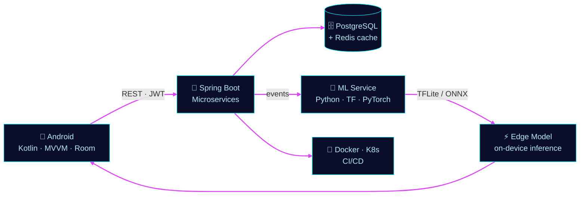
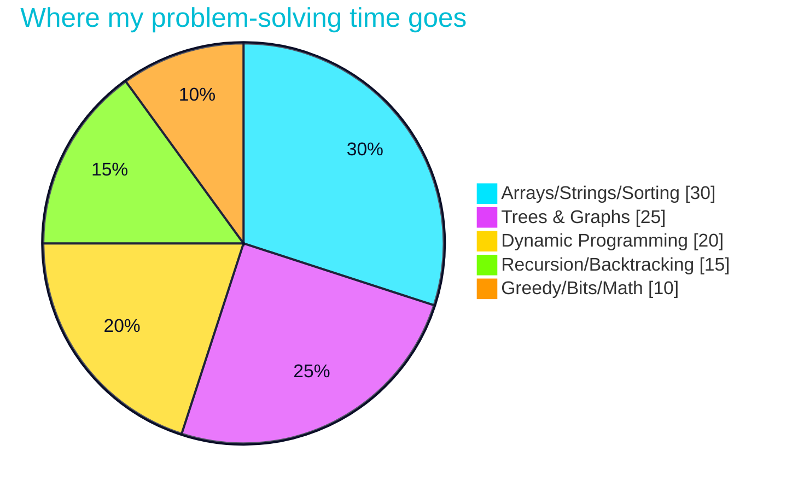
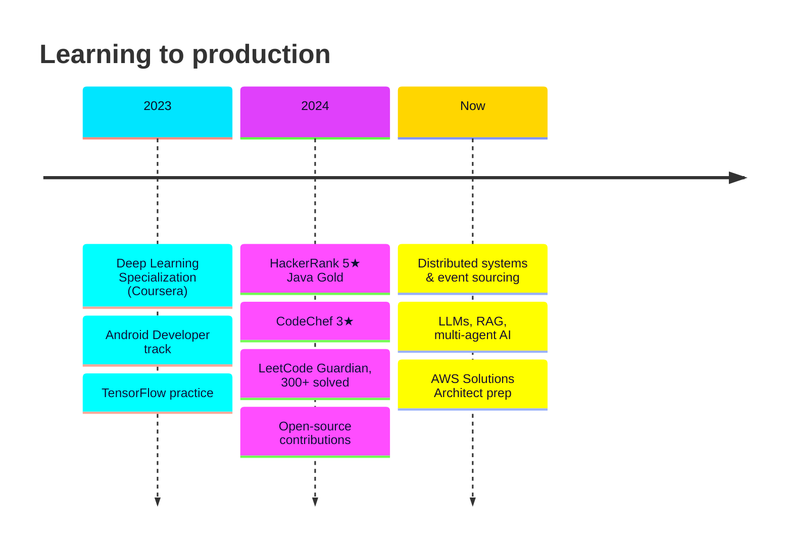

<!-- ═══ ABHAY SINGH YADAV · ULTRA-ANIMATED PROFILE (fixed) ═══ -->

<h1>👋 🧠 🚀 📱 ⚡ 🔥</h1>

  

<h2 align="center">💻 </h2>

>>+system+ready.+let%27s+build+something." alt="boot sequence"/>

<table><tr>
<td align="center"> <b>Java</b></td>
<td align="center"> <b>Deep Learning</b></td>
<td align="center"> <b>Problems solved</b></td>
<td align="center"> <b>HackerRank</b></td>
</tr></table>

<h2 align="center">🛰️ </h2>

**A phone captures → a backend orchestrates → a model decides → the edge answers.**

<h2 align="center">🚀 </h2>

<table>
<tr>
<td width="33%" align="center" valign="top">
<h1>🛡️</h1>
<h3>NightGuard</h3>
AI surveillance that detects events in video streams  
<code>Python</code> <code>OpenCV</code> <code>YOLO</code> <code>Spring Boot</code>  

</td>
<td width="33%" align="center" valign="top">
<h1>🏙️</h1>
<h3>UrbanPulse</h3>
Civic platform connecting citizens and city issues  
<code>Kotlin</code> <code>Spring Boot</code> <code>PostgreSQL</code>  

</td>
<td width="33%" align="center" valign="top">
<h1>🧰</h1>
<h3>ML Toolkits</h3>
Open-source utilities for training and evaluation  
<code>Python</code> <code>PyTorch</code>  

</td>
</tr>
</table>

<h2 align="center">🧩 </h2>

 

 
 
 

<b>🎚️ How deep am I, honestly?</b>

| 🔥 Daily drivers | 🙂 Comfortable | 🌱 Exploring |
|:--|:--|:--|
| Java, Spring Boot, Kotlin/Android, Python | TensorFlow/Keras, Docker, SQL, CNNs/LSTMs | PyTorch, Kafka, AWS, RAG, multi-agent systems |

<h2 align="center">🏆 </h2>

| Platform | Standing | Solved |
|:--|:--|:--:|
|  | **Guardian** | **300+** |
|  | **5★ Java, Gold** | **200+** |
|  | **3★** | **150+** |
|  | **Specialist** | **100+** |

<h2 align="center">📈 </h2>

<!-- Generated by the workflow in .github/workflows/profile-assets.yml (run it once from the Actions tab) -->

<picture>
  <source media="(prefers-color-scheme: dark)" srcset="https://raw.githubusercontent.com/Abhay9889/Abhay9889/output/snake-dark.svg"/>
  
</picture>

<h2 align="center">🧭 </h2>

<h2 align="center">🤝 </h2>

<b>Ask me about…</b>

- Wiring an Android app to a Spring Boot backend that scales
- Shipping a CNN/YOLO model to mobile with TFLite
- Building a RAG pipeline with LangChain
- Cracking DSA interviews: lessons from 500+ problems

 

